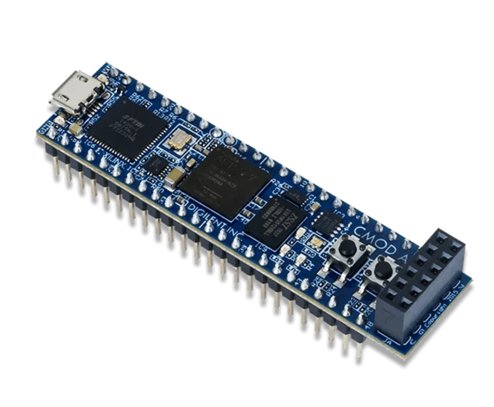
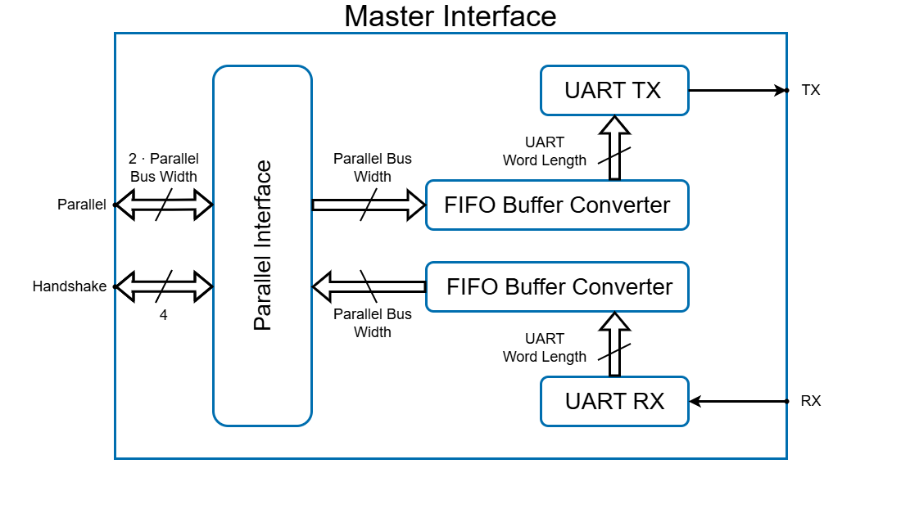
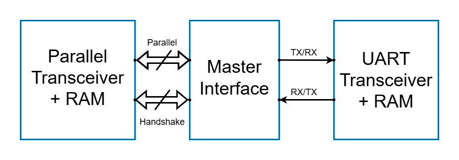
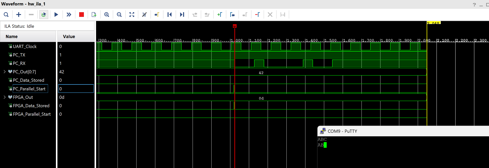
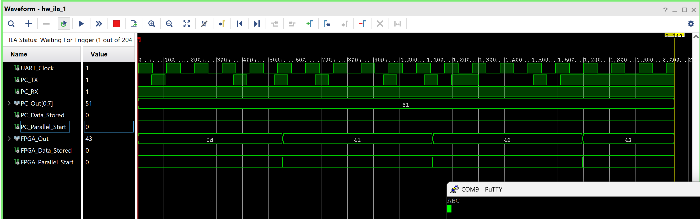

# FPGA Communication System
Designed, simulated, and validated in hardware a communication system connecting a PC, an FPGA board, and an external transceiver using from-scratch UART and parallel interface implementations.

Author: Arkadiusz Rozmarynowicz.

## Table of contents
* [General information](#general-information)
* [Technologies used](#technologies-used)
* [Project structure](#project-structure)
* [Example](#example)

## General information
- Built a synthesizable structure that converts parallel bus communication to UART and vice versa
- Implemented fully parameterized modules from scratch:
    - UART interface, i.e., one that supports custom baud rates, clock frequencies, frame formats,
    - parallel interface, i.e., one that is compatible with custom bus widths and clock frequencies.
- Constructed a universal, robust, and parameterized FIFO buffer converter that builds frames of a certain size from data frames of a different size, and also reports errors and warnings:
    - enables conversion of UART frames of any size to parallel frames of any size, and vice versa.
- Built a simulation testbench consisting of two additional transceivers that exchanged data through the main module:
    - tested multiple configurations and analyzed correctness on digital waveforms.
- Implemented the project on the Cmod S7 Digilent board, connecting a virtual parallel interface and a PC serial terminal:
    - utilized Virtual Input/Output (VIO) to simulate the parallel interface,
    - utilized Integrated Logic Analyzer (ILA) to analyze the correctness of communication.

 
<em>Figure 1: Cmod S7 Digilent board.</em>

## Technologies used
- IDE: Vivado 2025.
- Board: Cmod S7 by Digilent.
- Communication protocols:
    - UART
    - Parallel
- VIO and ILA cores.

## Project structure
Source files are contained within the [FPGA_Comm](/FPGA_Comm/) folder. There you can find design, simulation, and hardware files.

The synthesizable structure of the converter is shown below in the figure 2. Note that the "Master_Interface" is the top module acting as the converter. Also, internal error and warning signals were skipped in this schematic. Notes next to arrows inside the main node describe buses' widths.

 
<em>Figure 2: Master Interface internal diagram.</em>

The structure of the simulation testbench is shown in figure 3. Both the parallel transceiver and the UART transceiver store data in RAM to assert the correctness of data transfers. The parallel transceiver on the left sends, reads, and compares data from the UART transceiver on the right. Note that the widths of buses were omitted in the diagram: they are, however, compliant with what is shown on figure 2, where the parallel bus width is customizable.

 
<em>Figure 3: Simulation testbench diagram.</em>

In hardware implementation, a VIO core plays the role of the parallel transceiver, and a PC serial terminal, along with an onboard USB-UART bridge, play the role of the UART transceiver.

## Example
In Figures 4 and 5, example waveforms are presented. In the first case, a letter "B" (0x42) was sent from VIO to a PuTTY terminal, through the FPGA unit and a USB-UART bridge (other visible letters were sent beforehand). In the second case, a string of letters "ABC" (0x41, 0x42, 0x43) was sent the other way around. Note that in the latter case, the PC_Data_Stored handshake was omitted, as it was impractical to control it manually in VIO.

 
<em>Figure 4: Transfer from FPGA to PC.</em>

 
<em>Figure 5: Transfer from PC to FPGA.</em>

